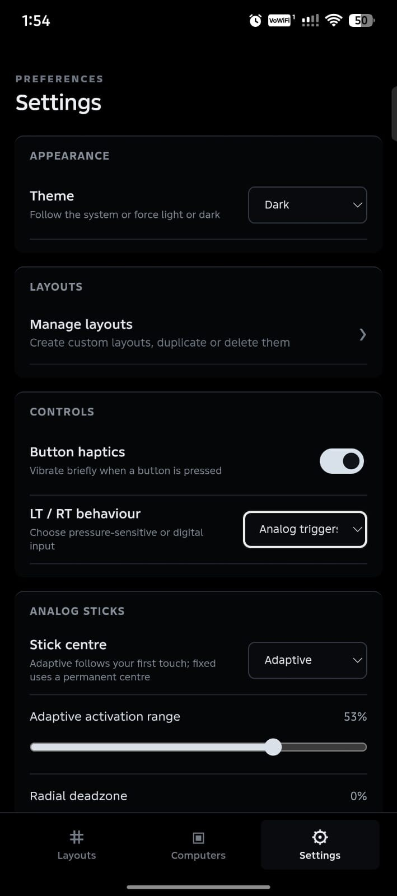

# TouchBridge

TouchBridge turns Android phones into customizable wireless controllers for a Windows or Linux PC over a local network.

[GitHub repository](https://github.com/Spont-427/touchbridge-controller) · [Releases](https://github.com/Spont-427/touchbridge-controller/releases) · [Report a bug](https://github.com/Spont-427/touchbridge-controller/issues)

**Version:** `0.8.0` · **Release status:** preparing the next stable release

## Screenshots

**Controller layout**

<p align="center">
  
</p>

**Android app**

<table>
  <tr>
    <th align="center">Layout library</th>
    <th align="center">Settings</th>
  </tr>
  <tr>
    <td align="center"></td>
    <td align="center"></td>
  </tr>
</table>

## Download

You need the Android app on each phone and the desktop server on your PC. Download both from the release assets. You do not need to clone this repository or compile the project.

### Android app

<p>
  <a href="https://github.com/Spont-427/touchbridge-controller/releases/download/v0.8.0/TouchBridge-0.8.0.apk">
    
    <strong>Download TouchBridge 0.8.0 for Android</strong>
  </a>
</p>

The stable APK includes the TouchBridge launcher icon, so the app is identifiable in the Android app drawer and installer. It is signed with the project's private release key and is the recommended download for normal use.

[Download the separate debug APK (for testing)](https://github.com/Spont-427/touchbridge-controller/releases/download/v0.8.0/TouchBridge-0.8.0-debug.apk)

The debug APK is debug-signed and may expose WebView debugging. Use it for testing and troubleshooting, not as the normal stable installation. The `Release downloads` workflow builds and attaches it automatically. Only install APKs from the official TouchBridge Releases page. Android may still show its normal prompt for installing apps from outside the Play Store; an app icon does not replace Android's installation and security checks.

### In-app updates

In the Android app, open **Settings → About → App updates** and tap **Check for updates**. TouchBridge checks the latest stable GitHub release. When an update is available, it downloads the matching APK, checks the package name, version and signing certificate, then opens Android's installer for your confirmation. Updates are not installed silently.

The stable updater requires future stable APKs to use the same private signing key. Debug builds use a separate debug key and are intended for testing.

### Desktop server

Choose the package for your PC:

| PC | Download | Start it |
|---|---|---|
| Windows x64 (Intel/AMD) | [TouchBridge for Windows (.zip)](https://github.com/Spont-427/touchbridge-controller/releases/download/v0.8.0/TouchBridge-Windows-x64.zip) | Extract the ZIP and double-click `Start-TouchBridge.bat`. Run `Setup-TouchBridge-Windows.bat` once for virtual gamepad support. |
| Linux x86_64 | [TouchBridge for Linux x86_64 (.tar.gz)](https://github.com/Spont-427/touchbridge-controller/releases/download/v0.8.0/TouchBridge-Linux-x86_64.tar.gz) | Extract the archive and run `./Install-TouchBridge-Linux.sh` in a terminal. |
| Linux ARM64 | [TouchBridge for Linux ARM64 (.tar.gz)](https://github.com/Spont-427/touchbridge-controller/releases/download/v0.8.0/TouchBridge-Linux-ARM64.tar.gz) | Extract the archive and run `./Install-TouchBridge-Linux.sh` in a terminal. |

The `Release downloads` GitHub Actions workflow builds and attaches the Windows and Linux packages plus the Android debug APK when a GitHub Release is published. Build the stable signed APK on your release machine with `scripts/build-android-release.sh`, then upload `TouchBridge-0.8.0.apk` to the same release.

## Features

- Connect up to four Android phones to one PC at the same time. Each phone receives its own player slot (`P1`–`P4`) and virtual gamepad.
- A fifth connection is refused while all four slots are in use. Disconnected player slots are reused.
- Each player has independent gamepad state. Shared keyboard keys and mouse buttons remain held until their last player releases them.
- Customizable layouts with analog sticks, D-pad, face buttons, triggers, steering wheel and racing pedals.
- Adaptive sticks move the complete stick face to the first touch point for the duration of the gesture; fixed-centre mode is also available.
- Import and export controller layouts as JSON. Older `Stick click L/R` labels are migrated to `L3/R3 click`.
- Keep the phone screen awake while the controller is open. This is enabled by default and can be changed under **Settings → Controls & haptics**.
- Check for stable Android updates from **Settings → About**. Downloaded APKs are checked against the installed package and signing certificate before Android's installer is opened.
- PIN pairing, trusted reconnection and automatic PC discovery.
- Linux mouse, keyboard and virtual gamepad support through `/dev/uinput`.
- Windows mouse and keyboard support, plus an Xbox 360-compatible virtual gamepad through ViGEmBus when installed.

## Connect your phones to your PC

1. Start the desktop server on your PC.
2. Connect each phone and the PC to the same trusted Wi-Fi network.
3. Open TouchBridge on each phone and select **Computers**.
4. Tap **Find computers** and select your PC. You can enter its address manually if it is not found.
5. Enter the six-digit PIN shown by the desktop server.

The server must remain running while the phones are being used as controllers.

## Platform support

- **Android:** Android 6.0 or newer.
- **Linux:** mouse, keyboard and up to four generic virtual gamepads through `/dev/uinput`, subject to kernel support and permissions.
- **Windows:** mouse and keyboard out of the box; up to four Xbox 360-compatible virtual gamepads through ViGEmBus 1.22.0 when installed.

## Build from source

Most users should use the downloads above. These steps are for developers.

### Android

Requirements: JDK 17, Android SDK Platform 35 and Android SDK Build Tools 36.0.0. The project uses Android Gradle Plugin 9.5.2 and the Gradle 9.6.0 wrapper.

Build a debug APK for testing:

```sh
./scripts/build-android-debug.sh
```

Build a signed stable APK after configuring your private release keystore as described in [Android APK build instructions](android-client/BUILD-APK.md):

```sh
./scripts/build-android-release.sh
```

The scripts write APKs to `dist/`. Do not commit generated APKs or signing keys.

### Desktop server

Requirement: Go 1.23 or newer.

```sh
go build -o touchbridge ./cmd/touchbridge
./touchbridge
```

Build the Windows and Linux packages locally:

```sh
./scripts/package-release.sh
```

The packages are created in `dist/`.

## Security

The default HTTP/WebSocket connection is not encrypted. Use TouchBridge only on a trusted private network unless you configure TLS. Do not expose its ports directly to the public internet.

The in-app updater checks the APK package name, version, version code and signing certificate before opening Android's package installer. Keep the stable release keystore private and use the same key for every stable update. Windows virtual gamepad output depends on the optional third-party ViGEmBus driver; see [Windows gamepad setup](docs/windows-gamepad.md).

## Documentation

- [Linux setup](docs/linux-setup.md)
- [Windows gamepad](docs/windows-gamepad.md)
- [Controller UI](docs/controller-ui.md)
- [Network protocol](docs/protocol.md)
- [Validation record](docs/validation.md)
- [Security notes](SECURITY.md)
- [Changelog](CHANGELOG.md)
- [Release notes](RELEASE-NOTES.md)

## License

TouchBridge is licensed under the [MIT License](LICENSE).
