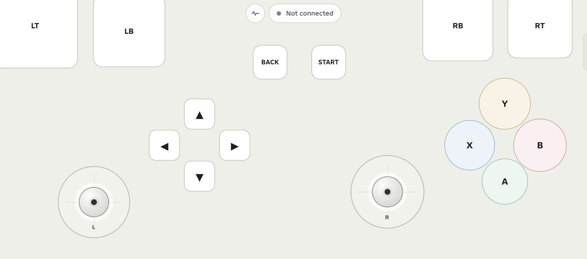
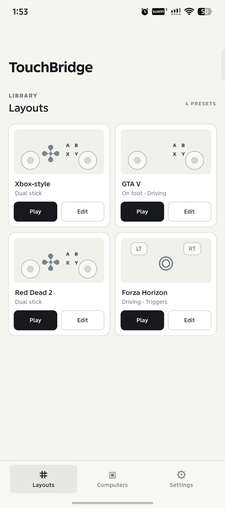

# TouchBridge

[GitHub repository](https://github.com/Spont-427/touchbridge-controller) · [All releases](https://github.com/Spont-427/touchbridge-controller/releases)

TouchBridge lets you use an Android phone as a controller for a Windows or Linux PC over your local network.

**Current version:** `0.5.3-alpha` · **Status:** Alpha

## Screenshots

**Controller layout (landscape)**

<p align="center">
  
</p>

**Android app**

<table>
  <tr>
    <th align="center">Layout library</th>
    <th align="center">Settings</th>
  </tr>
  <tr>
    <td align="center"></td>
    <td align="center"></td>
  </tr>
</table>

## Download TouchBridge

You need two parts: the Android app on your phone and the desktop server on your PC. Download both from the links below. You do not need to clone this repository, install Go, or compile the project.

### 1. Android app

[**Download TouchBridge for Android (APK)**](https://github.com/Spont-427/touchbridge-controller/releases/download/v0.5.3-alpha/TouchBridge-0.5.3-alpha-debug.apk)

1. Download the APK on your Android phone.
2. Open it from your Downloads notification or Downloads folder.
3. Tap **Install**, then **Open**.
4. Android may ask you to allow your browser or file manager to install apps from that source. Allow it for the app you are using, finish the installation, and turn the permission off again afterwards if you prefer.

This is an alpha debug build for testing, not a Play Store release. It may contain bugs. Only install APKs downloaded from the official TouchBridge Releases page.

### 2. Desktop server (Windows or Linux)

Choose the download for your PC:

| Your PC | Download | How to start |
|---|---|---|
| Windows x64 (Intel/AMD) | [**TouchBridge for Windows x64 (.zip)**](https://github.com/Spont-427/touchbridge-controller/releases/download/v0.5.3-alpha/TouchBridge-Windows-x64.zip) | Extract the ZIP, optionally run `Setup-TouchBridge-Windows.bat` once, then double-click `Start-TouchBridge.bat`. |
| Linux, 64-bit Intel/AMD | [**TouchBridge for Linux x86_64 (.tar.gz)**](https://github.com/Spont-427/touchbridge-controller/releases/download/v0.5.3-alpha/TouchBridge-Linux-x86_64.tar.gz) | Extract the archive and run `./Install-TouchBridge-Linux.sh` in a terminal. |
| Linux, ARM64 | [**TouchBridge for Linux ARM64 (.tar.gz)**](https://github.com/Spont-427/touchbridge-controller/releases/download/v0.5.3-alpha/TouchBridge-Linux-ARM64.tar.gz) | Extract the archive and run `./Install-TouchBridge-Linux.sh` in a terminal. |

**Windows:** Extract the ZIP and double-click `Start-TouchBridge.bat`. Keep the server window open while using TouchBridge; the six-digit pairing PIN appears there. If Windows Firewall asks, allow TouchBridge on **Private networks only**. Because the executable is not code-signed, Windows may show a SmartScreen warning; only run it if you downloaded it from the official TouchBridge release. Mouse and keyboard input work out of the box. For gamepad output, run `Setup-TouchBridge-Windows.bat` once: it installs [ViGEmBus 1.22.0](https://github.com/nefarius/ViGEmBus/releases/tag/v1.22.0) after verifying its SHA-256, and adds private-network firewall rules. See [Windows gamepad](docs/windows-gamepad.md). The TouchBridge server itself never asks for administrator rights.

**Linux:** The installer asks for administrator permission to configure `/dev/uinput` and install the server. It then starts TouchBridge and displays the pairing PIN. See [Linux setup](docs/linux-setup.md) for details.

### 3. Windows gamepad (optional)

Windows has no built-in API for creating a virtual gamepad, so controller output needs the third-party ViGEmBus driver. Mouse and keyboard input work without it.

1. Double-click `Setup-TouchBridge-Windows.bat` from the extracted ZIP. Windows will show a UAC prompt. The script downloads ViGEmBus 1.22.0 from the official release, verifies its SHA-256 checksum, installs it, and adds private-network firewall rules for TCP 8765 and UDP 8766. Restart Windows if the installer asks.
2. Double-click `Start-TouchBridge.bat` as usual. The first gamepad input from a paired phone creates an Xbox 360-compatible controller.
3. Verify it in **Control Panel → Set up USB game controllers** (or run `joy.cpl`). Games that use XInput will see it as a normal controller.

The setup script is rerunnable and skips anything already present. The TouchBridge server still runs unprivileged; only the setup script's driver and firewall changes request administrator rights. Without ViGEmBus, the `capabilities` response reports no gamepad backend and the app stays in mouse/keyboard mode. To install the driver yourself instead, use the [ViGEmBus 1.22.0 release](https://github.com/nefarius/ViGEmBus/releases/tag/v1.22.0). See [Windows gamepad](docs/windows-gamepad.md) for driver caveats and uninstall steps.

**Release downloads:** When a GitHub Release is published, the `Release downloads` workflow automatically builds and attaches the Windows and Linux packages. They appear under that release's **Assets** after the workflow finishes. The Android APK is built on the developer's release machine and attached separately. From the repository root, run `./scripts/build-android-release.sh`; it creates `dist/TouchBridge-0.5.3-alpha-debug.apk`. Build on the same machine as the previous alpha APK to preserve the debug signing key and allow existing installations to update without losing app data. See [Android APK build instructions](android-client/BUILD-APK.md).

## Connect your phone to your PC

1. Start the desktop server on your PC using the instructions above.
2. Connect your phone and PC to the same trusted local Wi-Fi network.
3. Open TouchBridge on your phone and go to **Computers**.
4. Tap **Find computers** and select your PC. You can enter the PC address manually if it is not found.
5. Enter the six-digit pairing PIN shown by the desktop server.

The server must remain running while you use the phone as a controller.

## Features

- Customizable controller layouts with two analog sticks, a D-pad, buttons and triggers.
- Create, edit, duplicate, import and export layouts on Android.
- Offline layout editing and controller preview.
- Automatic PC discovery or manual server address entry.
- PIN pairing and trusted reconnection.
- Linux support for mouse, keyboard and a generic virtual gamepad.
- Windows support for mouse and keyboard, plus an Xbox 360-compatible (XInput) virtual gamepad when ViGEmBus is installed.

## Platform support

- **Android:** Android 6.0 or newer.
- **Linux:** mouse, keyboard and generic virtual gamepad through `/dev/uinput`, subject to kernel support and permissions.
- **Windows:** mouse and keyboard out of the box; an Xbox 360-compatible virtual gamepad through ViGEmBus when the driver is installed.

## Build from source

These steps are for developers or users who want to build the project themselves. Most users should use the downloads above instead.

### Android app

Requirements: JDK 17 and Android SDK 35.

```sh
cd android-client
./gradlew assembleDebug
```

The debug APK is created at:

```text
android-client/app/build/outputs/apk/debug/app-debug.apk
```

### Desktop server

Requirement: Go 1.23 or newer.

Build and run for your current platform:

```sh
go build -o touchbridge ./cmd/touchbridge
./touchbridge
```

To build the Windows and Linux release packages locally:

```sh
./scripts/package-release.sh
```

The packages are created in `dist/`.

## Security

The default connection is not encrypted. Use TouchBridge only on a trusted private network unless you configure TLS. Do not expose its ports directly to the public internet.

Windows gamepad output depends on the third-party ViGEmBus kernel driver. TouchBridge does not bundle it; the optional setup script downloads the pinned official release, verifies its SHA-256, and runs it only after you approve the UAC prompt. Install it only from the official release linked above.

## Documentation

- [Linux setup](docs/linux-setup.md)
- [Windows gamepad](docs/windows-gamepad.md)
- [Controller UI](docs/controller-ui.md)
- [Network protocol](docs/protocol.md)
- [Validation record](docs/validation.md)
- [Security notes](SECURITY.md)
- [Changelog](CHANGELOG.md)

## License

TouchBridge is licensed under the [MIT License](LICENSE).
